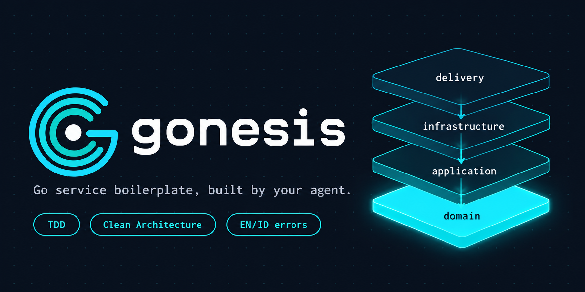

<p align="center"> <picture> <source media="(prefers-color-scheme: dark)" srcset="assets/gonesis-hero-banner.png"> <source media="(prefers-color-scheme: light)" srcset="assets/gonesis-hero-banner.png">  </picture> </p>

# Gonesis

An agent skill that builds a **Go service boilerplate** from your requirements: four Clean Architecture layers at the service root, one fully tested **Task Tracking** reference feature, structured logging, localized (EN/ID) errors, and verification evidence you can check.

> Gonesis is a skill, not a code template. It holds the instructions an AI coding agent follows to design, implement, and verify a Go service. The agent writes the service for your target repository.

## What you get

When the skill runs to completion, the generated service has:

- **Four root layers**: `domain/`, `application/`, `delivery/`, `infrastructure/`, with dependencies pointing inward.
- **A working reference feature**: Task Tracking (`Todo → In Progress → Done`) covering rules BR-01 to BR-09, built test-first with RED/GREEN evidence.
- **Foundations**: environment-based configuration with a secret-free `.env.example`, JSON logging with masking, typed errors, EN/ID translations, and a standard JSON response envelope.
- **Contracts before handlers**: API documentation under `docs/api/`, plus business-rule documentation.
- **Design assessment**: one owning feature document with tactical/technical design, ticket references, review after GREEN, and justified refactoring with regression evidence.
- **Tooling**: all-package `go test`, lint, vulnerability check, repeatable architecture (dependency-direction) checks, and Mockery-generated mocks where tests need them.
- **Runtime composition**: resource setup, feature wiring, and enabled HTTP/RPC/worker entry points have separate responsibilities; outbound RPC clients are optional dependencies selected independently of servers.
- **Runtime proof**: lifecycle checks and create → start → complete → view through the actual composition, including one total shutdown budget; HTTP services also verify local `/health` smoke.

Out of scope for the initial workflow: packaging and image publication, provisioning, deployment, and additional business features. Commits and merge requests happen only if you ask for them.

## How it works

You describe what you want in a `requirement.txt`. The skill does not guess implementation-determining choices; it asks about anything left blank or `unresolved`.

You decide five areas:

1. **Persistence**: storage medium, restart behavior, consistency.
2. **Internal events**: dispatch mechanism, publication point, failure semantics, durability.
3. **Time**: representation, precision, boundaries, timestamp ownership.
4. **API**: operations, payloads, identifiers, validation, statuses.
5. **Verification**: expectations, architecture constraints, available resources, limits.

The agent supplies the rest: formal API contract, package and test paths, compatible dependency versions, and the check commands.

The work then follows seven stages: needs and decisions → isolated workspace → module and layout → foundations and contracts → TDD implementation and wiring → tooling and docs → verification and handoff. Details are in [`references/workflow.md`](references/workflow.md).

## Install

The repository root is the skill: `SKILL.md` sits next to `references/`.

**With the `skills` CLI (recommended):**

```sh
npx skills add rfanazhari/gonesis
```

By default this installs into the current project's agent directories. Useful flags: `-g` installs for your user account across all projects, `-a claude-code` targets a specific agent, `-y` skips prompts, and `--list` previews what the CLI finds without installing. For example, a global install for Claude Code:

```sh
npx skills add rfanazhari/gonesis -g -a claude-code -y
```

**Manual install with Git.** Cloning into a skills directory named `gonesis` is enough.

**Claude Code, personal (all your projects):**

```sh
git clone https://github.com/rfanazhari/gonesis ~/.claude/skills/gonesis
```

**Claude Code, project-level (shared through the repository):**

```sh
git clone https://github.com/rfanazhari/gonesis .claude/skills/gonesis
```

Other agents that read `SKILL.md` folders can use the same layout; place the `gonesis` folder in that agent's skills directory.

Files that are not part of the skill (this README, `LICENSE`, `CONTRIBUTING.md`, `CHANGELOG.md`, `scripts/`, `.github/`) sit beside `SKILL.md` and are ignored by the agent.

## Usage

1. Copy the annotated template and fill it in. Replace every `<answer>` with a choice, `none`, `not applicable` (with a reason), or `unresolved`. Never put secrets in it.

   ```sh
   cp ~/.claude/skills/gonesis/references/requirement.txt ./requirement.txt
   ```

   [`references/requirement.example.txt`](references/requirement.example.txt) shows a completed answer. It is an illustration, not a default.

2. Ask your agent to use the skill, for example:

   > Use the gonesis skill to build a new Go service from `requirement.txt`.

3. Answer any focused follow-up questions about missing decisions.

4. Review the handoff report: changed files, enabled components, commands run and their results, rule-to-test evidence, API and smoke results, and any failed, blocked, or not-applicable checks.

The skill only declares completion when every acceptance criterion and required check passes. A blocked check is reported as unfinished, never as passed.

## Conventions the skill enforces

These are opinionated defaults. Adjust the references if your team differs.

- Clean Architecture with DDD tactical patterns where real business rules justify them; KISS, YAGNI, SRP.
- TDD for the Task example, with table-driven tests, `testify`, controllable time, and Mockery-generated mocks (no handwritten mocks).
- Verification through `go test`, not `go build` or `go run`.
- Logging with [`salt-pkg/logmanager`](https://github.com/SALT-Indonesia/salt-pkg) is required. `clientmanager`, `httpmanager`, and `eventmanager` are used when they fit. These are third-party libraries with their own licenses and are not bundled here.
- Localization with `go-i18n/v2`; requests validated with `go-playground/validator`.
- Standard JSON envelope: `status` and `data` always present, `error` only on failures.

See [`references/libraries.md`](references/libraries.md) for version-specific API findings and known gaps.

## Repository layout

```text
gonesis/
├── SKILL.md                    # skill entry point
├── references/
│   ├── README.md               # index of the reference set
│   ├── workflow.md             # stages, dependencies, completion gates
│   ├── requirements.md         # input fields and validation rules
│   ├── requirement.txt         # annotated input template
│   ├── requirement.example.txt # filled example (not a default)
│   ├── service-layout.md       # directory tree and composition root
│   ├── runtime-lifecycle.md    # modes, ownership, startup, supervision, shutdown
│   ├── go-standards.md         # architecture, style, config, security
│   ├── example-task.md         # Task Tracking rules and scenarios
│   ├── design-assessment.md    # ownership, assessment, justified refactoring
│   ├── api-errors.md           # contracts, envelope, errors, i18n, health
│   ├── testing.md              # TDD, fixtures, mocks, architecture checks
│   ├── persistence-events.md   # storage, SQL, migrations, events
│   ├── libraries.md            # library policy and API verification
│   ├── verification.md         # final checks and blocker handling
│   ├── git-documentation.md    # worktrees, commits, business docs
│   └── sources.md              # dependency evidence and maintenance notes
├── scripts/
│   └── check_skill.py          # validates frontmatter and local links
└── .github/workflows/
    └── validate.yml            # runs the check on push and pull request
```

## Validate this repository

The reference set is only useful if its links and metadata stay consistent. This check verifies the `SKILL.md` frontmatter and that every local Markdown link resolves inside the repository:

```sh
python3 -I scripts/check_skill.py
```

It establishes packaging consistency only. It does not prove that a generated service behaves correctly.

## Contributing

Issues and pull requests are welcome. See [CONTRIBUTING.md](CONTRIBUTING.md) for how to edit rules, keep navigation intact, and run the check.

## License

Released under the [MIT License](LICENSE.md).
